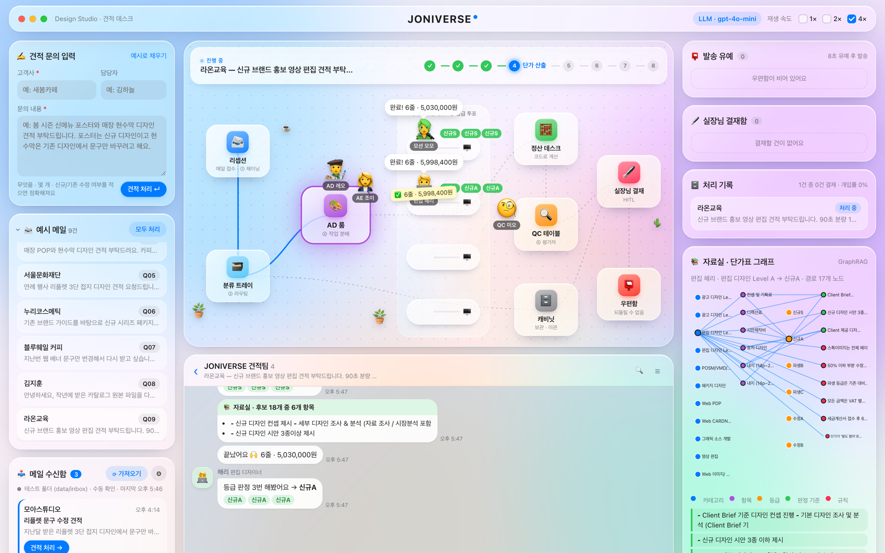

# JONIVERSE 견적 데스크 — 사람이 승인하는 견적 자동 회신 에이전트

디자인 외주 견적 요청 메일을 읽고, 단가표로 견적서를 만들어 회신하는 LangGraph 에이전트입니다.
**위험한 건에서만 멈춰 실장님(사람)의 결재를 받고**, 나머지는 자동으로 처리합니다.
자동으로 처리되는 건도 곧바로 나가지 않고 몇 초~몇 분 동안 발송을 미뤄 두어, 필요하면 사람이 붙잡을 수 있습니다.



설계와 검증 결과는 [REPORT.md](REPORT.md)에 있습니다.

## 무엇을 하나

```
견적 메일 → ① 요구사항 추출 → ② 분류 → ④ AD가 작업 분배 → 디자이너 ×N (병렬)
          디자이너: ③ 등급 3회 투표 → 📚 GraphRAG로 단가·판정 기준 조회 → 단가 줄 선택
       → 정산(코드) → ⑤ 문안 작성 ⇄ QC 검수 → 멈춤 판단
       → [기준 해당] 실장님 결재 (interrupt)  : 승인 / 수정 후 승인 / 다시 판정 / 반려
       → [기준 미해당] 발송 유예 (interrupt)  : 시간이 지나면 자동 발송 / 즉시 발송 / 보류 / 취소
       → 발송 (견적서 HTML 저장)
```

- LangGraph 워크플로 패턴 5가지(프롬프트 체이닝·라우팅·병렬화·오케스트레이터-워커·평가자-최적화자) + GraphRAG + HITL
- 멈춤 기준 6가지 (공급가 500만 원 초과 · 별도 협의 항목 · 등급 무리 불일치 · 표준 밖 조건 · 범위 밖 작업 · 검수 실패)
- 대기 건은 SQLite 체크포인터에 저장 → 서버를 껐다 켜도 이어서 결재·발송
- 웹 데모: 디자인 사무실 무대 애니메이션, 카톡 스타일 진행 대화, 자료실(GraphRAG) 경로 시각화, 결재 화면, 견적서 뷰어, 메일 수신함

## 설치

Python 3.11 이상.

```bash
python -m venv .venv && source .venv/bin/activate
pip install -r requirements.txt
cp .env.example .env
```

`.env` 에 `OPENAI_API_KEY` 를 넣으면 LLM 모드(gpt-4o-mini)로, 비워 두면 **API 키 없이 규칙 모드**로 동작합니다.
API 키는 저장소에 올리지 않습니다 (`.env` 는 `.gitignore` 에 있음).

| 변수 | 뜻 | 기본값 |
|---|---|---|
| `OPENAI_API_KEY` | OpenAI 키. 비우면 규칙 모드 | (없음) |
| `QUOTE_MODEL` | 사용할 모델 | `gpt-4o-mini` |
| `QUOTE_HOLD_SECONDS` | 기준 미해당 건의 발송 유예(초). 데모 10, 실운영 600 | `10` |
| `MAIL_PASSWORD` | 메일 수신함 IMAP 앱 비밀번호 (화면에서는 받지 않음) | (없음) |

## 실행

```bash
uvicorn server:app --port 8765          # 웹 데모 → http://localhost:8765
```

| 명령 | 하는 일 |
|---|---|
| `python build_ratecard.py` | 엑셀 견적단가표 → `data/rate_card.json` (이미 만들어 두었으니 엑셀이 바뀔 때만) |
| `python kg.py` | 단가표 지식 그래프 크기와 검색 예시 출력 |
| `python pipeline.py` | 예시 요청 9건을 터미널에서 처리 (멈춘 건은 대기 상태로 표시) |
| `python evaluate.py` | 멈춤 기준 비교표 (개입률·놓침·헛멈춤) — 개발용 31건 |
| `python evaluate.py holdout` | 같은 비교를 검증용 10건으로 (`--mock` 을 붙이면 규칙 모드) |
| `python scripts/demo_capture.py URL` | 시연 시나리오 실행 + 화면 캡처 (`docs/screenshots`, `docs/run_result.md`) |

## 데모 사용법

1. **문의 넣기** — 왼쪽 `✍️ 견적 문의 입력`에 직접 적거나, `📨 예시 메일`을 누르거나, `📥 메일 수신함`에서 `⟳ 가져오기` 후 `견적 처리 →`.
2. **지켜보기** — 가운데 사무실에서 AE 조이·AD 레오·디자이너·QC 미오가 움직이고, 아래 단톡방에 대화가 쌓입니다. 오른쪽 `📚 자료실`에 단가를 찾은 그래프 경로가 그려집니다.
3. **결재** — 기준에 걸린 건은 `🖋️ 실장님 결재함`으로 가고 결재 화면이 열립니다. `📄 나갈 견적서 미리보기`로 실제 문서를 확인한 뒤 승인·수정 후 승인·다시 판정·반려 중 하나를 고릅니다.
4. **발송 유예** — 기준에 걸리지 않은 건은 `📮 발송 유예`에서 카운트다운 후 자동 발송됩니다. 그 사이 `지금 발송`·`보류`(결재함으로)·`취소`를 할 수 있습니다.
5. **결과** — `🗄️ 처리 기록`에서 발송된 건을 누르면 견적서가 열립니다(인쇄/PDF 가능).
6. **처음부터 다시** — 화면 맨 아래 `↺ 처리 기록 초기화`.

### 메일 수신함 연결
`📥 메일 수신함`의 ⚙에서 가져올 곳을 고릅니다.
- **테스트 폴더**: `data/inbox/*.eml` 을 메일처럼 가져옵니다 (샘플 3통 포함).
- **메일 계정(IMAP)**: Gmail·네이버·다음·Outlook 프리셋. 비밀번호는 `.env` 의 `MAIL_PASSWORD` 에 앱 비밀번호로 넣고 서버를 다시 시작합니다. 메일은 읽기 전용으로 열어 읽음 표시를 바꾸지 않습니다.
- 자동 가져오기(N분마다)와 자동 견적 처리를 켤 수 있습니다.

## 파일 지도

| 파일 | 내용 |
|---|---|
| `pipeline.py` | LangGraph 그래프 전체 (노드·상태·interrupt·재개 경로) |
| `llm.py` | LLM 이 맡는 일: 요구사항 추출 · 등급 투표 · 견적 문안 (키가 없으면 규칙으로 대체) |
| `kg.py` | 단가표 지식 그래프(GraphRAG): 카테고리 → 항목 → 등급 → 판정 기준 → 규칙 |
| `pricing.py` | 단가 줄 선택과 금액 계산 (LLM 을 쓰지 않음) |
| `criteria.py` | 멈춤 기준과 각 기준이 막는 위험 |
| `config.py` | 모델·기준값·유예 시간·사무실 사람들 이름 |
| `quote_doc.py` | 고객에게 나가는 견적서(HTML, A4 인쇄용) |
| `mail_inbox.py` | 메일 수신함 (테스트 폴더 / IMAP) |
| `server.py` | FastAPI: 파이프라인 실행·SSE 이벤트·결재/유예 재개·유예 타이머·메일 |
| `web/` | 데모 화면 (HTML·CSS·JS, 빌드 없음) |
| `evaluate.py` | 멈춤 기준 검증 |
| `data/` | 단가표 JSON · 예시 요청 · 검증 세트 · 테스트 메일 |
| `docs/` | 검증 결과 · 시연 결과 · 화면 캡처 |
