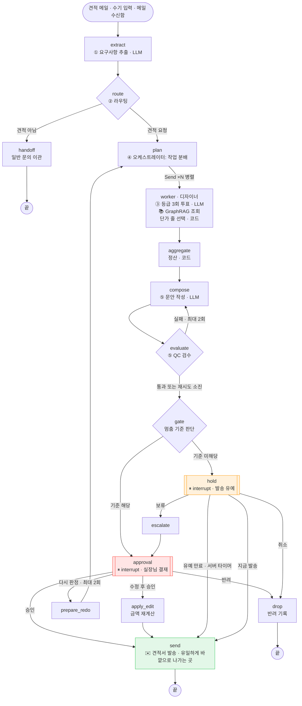
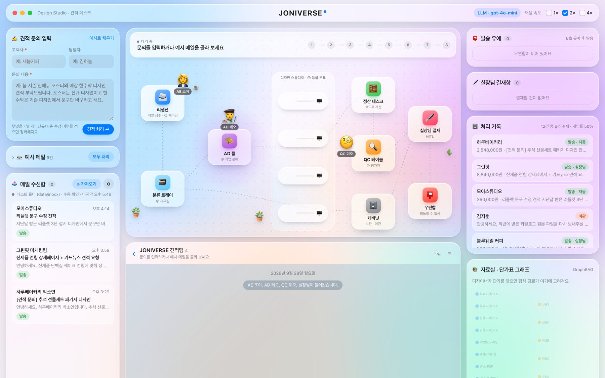
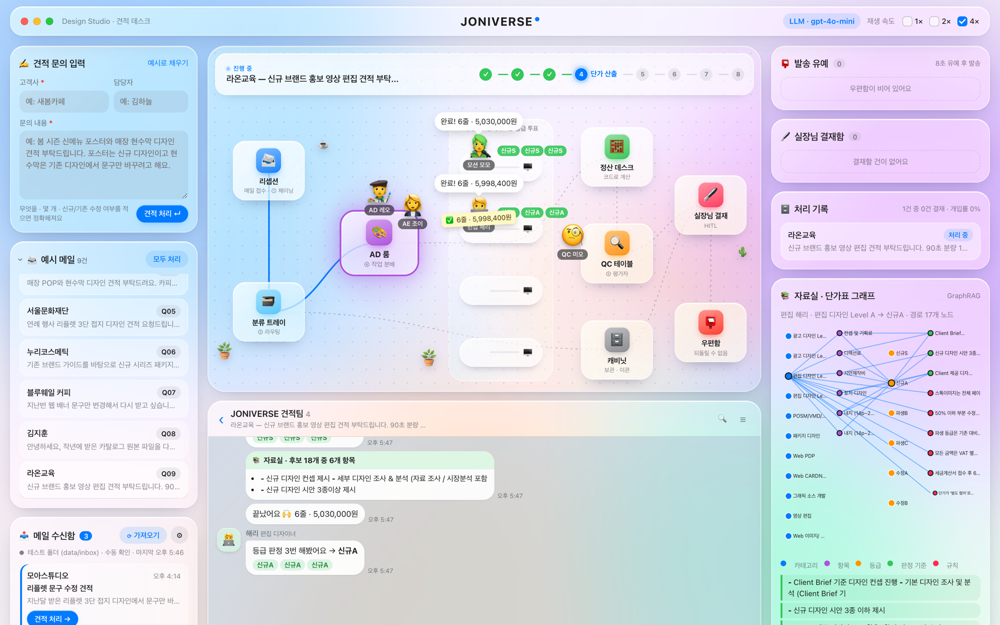
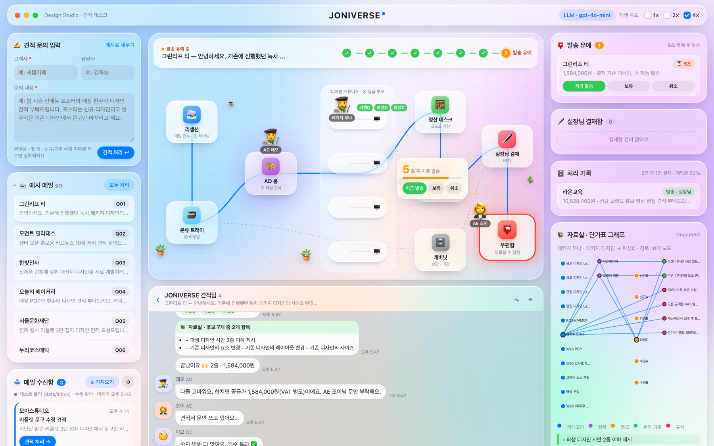
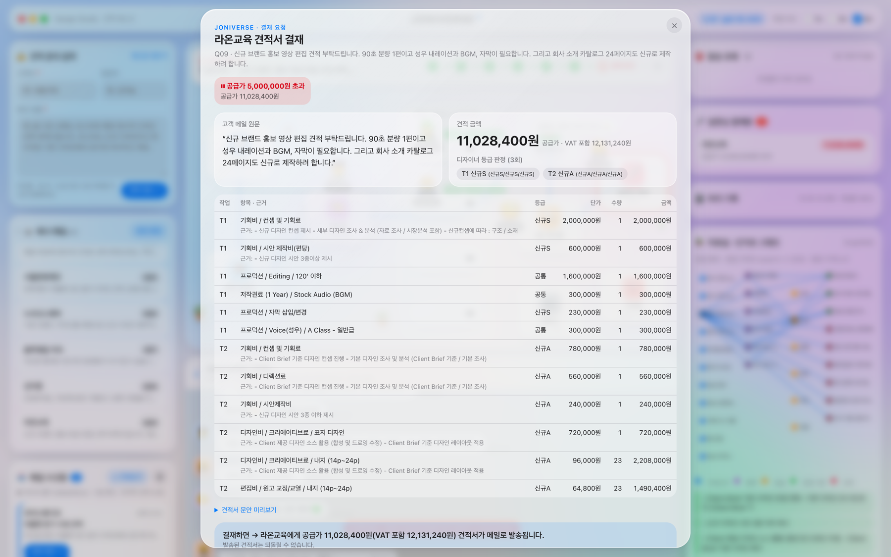
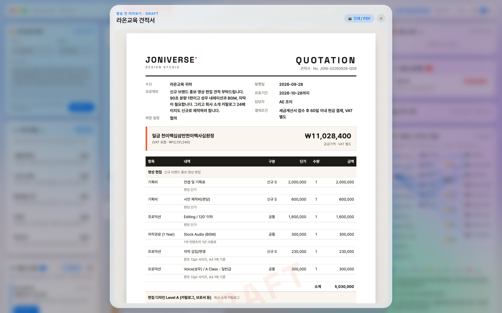
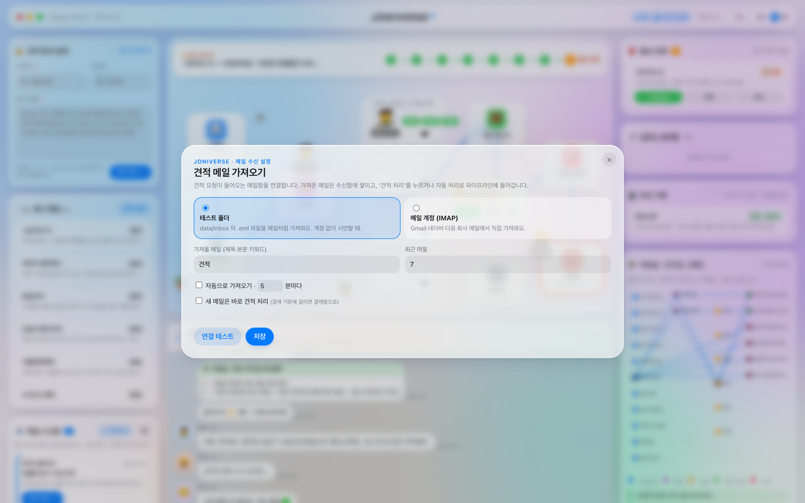
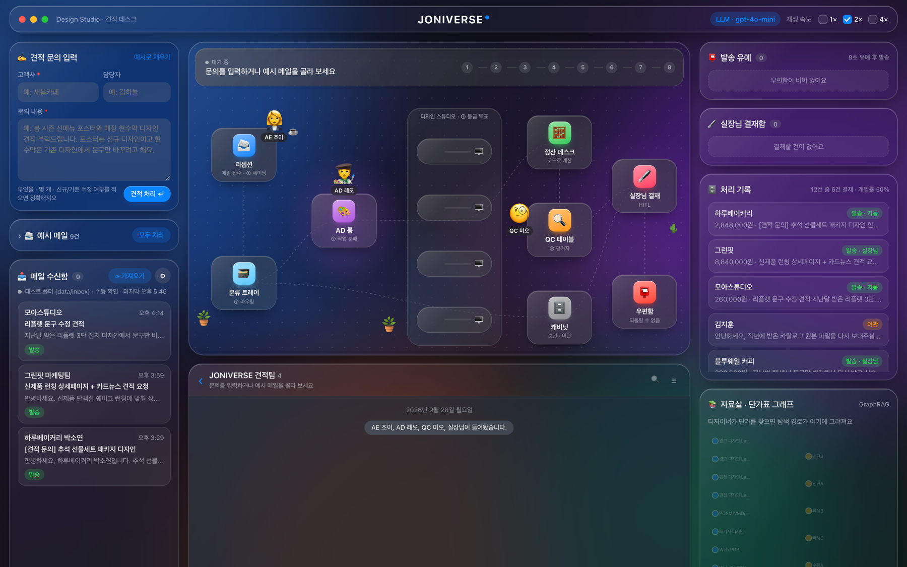

# REPORT — 사람이 승인하는 견적 자동 회신 에이전트

## 1. 주제와 고른 이유

**자동화한 업무:** 디자인 스튜디오(JONIVERSE)로 들어오는 외주 견적 요청 메일을 읽고, 사내 견적단가표(엑셀)로 견적서를 만들어 회신한다.

**결과가 바깥으로 나가는 순간:** 견적서를 고객에게 **발송하는 순간**이다. 한 번 보낸 가격은 고객에게 기준가가 되어, 낮게 잘못 보내면 손해를 감수하거나 신뢰를 잃고, 높게 잘못 보내면 수주를 놓친다. 발송 전까지(요청 해석·단가 계산·문안 작성)는 몇 번을 다시 해도 괜찮다.

**고른 이유**
- 실제로 하는 일이고, 판단 기준(단가표·등급 기준)이 엑셀로 이미 정리돼 있어 **계산 가능한 기준**을 세우기 좋다.
- 건마다 위험의 크기가 크게 다르다. "기존 패키지 사이즈만 변경"은 158만 원이고 누가 봐도 명확하지만, "신규 패키지 5종 + 구조 개발"은 2,900만 원이고 등급 판단 하나로 금액이 크게 갈린다. 모든 건을 사람이 볼 필요도, 모두 자동으로 보낼 수도 없는 업무다.
- 강의에서 다룬 환불 승인과는 다른 업무다.

## 2. 파이프라인 구조

### 2-1. 구조도

### 2-2. 상태(State)

| 키 | 채우는 노드 | 내용 |
|---|---|---|
| `request` | 입력 | 요청 id · 고객 · 담당자 · 메일 원문 |
| `extraction` | extract | 산출물 목록(카테고리·수량·페이지·옵션·등급 근거 구절), 희망 일정, 표준 밖 조건, 범위 밖 작업 |
| `tasks` | plan | 디자이너에게 나눠 준 작업 |
| `lines` · `grade_votes` | worker (병렬 합치기) | 단가 줄(단가·수량·근거·가정) · 등급 투표 결과 |
| `quote` | aggregate / apply_edit | 공급가 · VAT · 합계 |
| `draft` · `evaluation` · `compose_attempts` | compose / evaluate | 견적 문안 · 검수 결과 · 재작성 횟수 |
| `stop_reasons` · `hold_until` | gate | 멈춘 이유 · 발송 유예 만료 시각 |
| `decision` · `redo_count` | approval / hold | 사람의 답 · 다시 판정 횟수 |
| `status` | send / drop / handoff | 최종 결과 |

### 2-3. 패턴을 쓴 자리

| 패턴 | 자리 | 이유 |
|---|---|---|
| ① 프롬프트 체이닝 | 추출 → 분배 → 산출 → 정산 → 문안 → 검수 | 한 번에 견적서를 쓰게 하면 금액을 지어낸다. 단계를 나누고 사이에 검사를 둔다 |
| ② 라우팅 | `route` | 견적이 아닌 메일(파일 재요청·세금계산서 문의)은 견적을 만들지 않고 이관 |
| ③ 병렬화 (투표) | 디자이너의 등급 3회 투표 (`batch`) | 등급(신규/파생/수정)이 금액을 가장 크게 좌우한다. 같은 질문을 세 번 던져 **의견이 갈리면 확신이 낮다는 신호** → 멈춤 기준 |
| ④ 오케스트레이터-워커 | AD가 산출물별로 디자이너에게 `Send` | "패키지 5종 + 상세페이지"처럼 카테고리가 섞인 요청을 카테고리 전문가가 동시에 산출 |
| ⑤ 평가자-최적화자 | 문안 작성 ⇄ QC 검수 (최대 2회) | 합계 일치, 핵심 단가 누락, **견적에 없는 금액이 문안에 등장**, 불포함 범위 누락을 코드로 검사하고 의견을 돌려준다 |
| GraphRAG | `kg.py` · 디자이너가 조회 | 단가표는 규칙이 여러 단계로 이어진다 (카드뉴스 → 스톡이미지 → "페이지의 70%" 규칙). 탐색 경로가 곧 결재 화면의 **근거**가 된다 |

**LLM 은 해석만, 계산은 코드.** LLM 은 요구사항 추출·등급 투표·문안 작성만 한다. 단가 선택과 합산은 `pricing.py` 가 한다. 같은 요청이면 같은 금액이 나와야 하고, 금액을 지어내면 안 되기 때문이다.

**GraphRAG 구성:** 엑셀 3개 시트(표준견적서·등급별 기준·샘플 제작 기준)를 파싱해 카테고리 11 · 단가 항목 119 · 등급 6 · 판정 기준 32 · 규칙 10 노드, 엣지 1,104개의 그래프를 만든다. 디자이너는 `카테고리 → 항목 → 등급 단가 → 판정 기준 문장 → 규칙` 순으로 걷고, 결재 화면의 각 단가 줄에 판정 기준 문장이 근거로 붙는다.

### 2-4. 멈추고 이어가기

- **interrupt 자리가 두 곳이다.** 기준에 걸린 건은 `approval`, 걸리지 않은 건은 `hold`에서 멈춘다. 발송(`send`)은 둘 다 지난 뒤에만 실행된다.
- **체크포인터는 SQLite**(`data/checkpoints.sqlite`)다. 실장님이 몇 시간 뒤에 결재해도, 그 사이 서버를 재시작해도 대기 건이 남는다 (재시작 후 유예 만료 → 자동 발송까지 확인함).
- **재개는 `Command(resume=...)`**, 건 구분은 `thread_id`(요청 id + 짧은 난수)다.
- **"멈춘 노드는 처음부터 다시 실행된다"** 는 원칙을 지켰다. `approval` · `hold` 안에서는 바깥으로 나가는 일을 하지 않는다. 유예 만료 시각도 `hold`가 아니라 앞의 `gate`에서 정해 상태에 남긴다 (`hold`가 재실행될 때 시각이 바뀌지 않도록).
- **유예 만료는 서버 타이머가 재개한다.** 1초마다 대기 목록을 훑어 만료된 건을 `auto_send`로 재개한다. 버튼과 타이머가 동시에 재개하지 않도록 실행 중 표시를 먼저 걸고 시작한다.

## 3. 승인 기준과 이유

### 3-1. 기준 목록

| 기준 (계산 가능한 형태) | 막으려는 위험 | 근거 |
|---|---|---|
| **공급가(VAT 별도) 500만 원 초과** | 큰 금액을 잘못 제시하면 손해가 크거나 수주를 놓친다 | 1,000만 원으로 올리면 검증에서 브로슈어 632만·패키지 3종 962만·연차보고서 881만을 놓쳤다 |
| **'별도 협의' 항목 포함** | 단가표에 금액이 없는 항목(POSM·카드뉴스·영상 카피, 240초 초과 영상 등)을 AI가 임의로 매기거나 빠뜨린다 | 엑셀 단가 칸에 '별도 협의'로 적힌 항목을 그래프 노드에 표시 |
| **등급 무리 불일치** (3표 중 신규/파생/수정이 갈림) | 신규와 파생을 헷갈리면 같은 작업의 금액이 1.5~2배 달라진다 | 처음엔 신규S/신규A 차이도 불일치로 봤더니 헛멈춤 5건. 막으려는 위험(무리 혼동)에 맞춰 고침 |
| **표준 밖 조건 요구** (할인·급행·무제한 수정·무료) | 단가표에 없는 약속을 자동으로 수락하게 된다 | LLM 추출 + 키워드 안전망 |
| **범위 밖 작업 포함** (촬영·인쇄 제작·목업·감리·번역 등) | 자동 산출하지 않는 작업이 **조용히 빠진 채** 견적이 나간다 | 기준 검증에서 발견해 추가 (아래 3-3) |
| **검수 실패** (재작성 2회 후에도) | 계산 오류·누락·지어낸 금액이 있는 견적이 나간다 | QC 검수 결과 |
| (자동) 실장님이 다시 판정을 요청한 건 · 유예 중 보류한 건 | 사람이 한 번 개입한 건은 결과도 사람이 본다 / 기준이 놓친 건 | 보류 사유는 기준 개선 재료로 남긴다 |

### 3-2. 자동으로 처리되는 건은 왜 괜찮은가

자동 처리 건은 **500만 원 이하이고, 단가표에 금액이 있는 항목만 들어갔고, 등급 판단이 세 번 모두 같은 무리이고, 특별한 조건이나 범위 밖 작업 요구가 없고, 검수를 통과한** 건이다. 예를 들면:

| 요청 | 결과 | 괜찮은 이유 |
|---|---|---|
| "기존 녹차 패키지 사이즈만 변경" | 파생C · 158만 원 | 등급 기준 "기존 디자인의 사이즈 변경"과 정확히 일치, 단가표 값 그대로 |
| "지난번 웹 배너 문구만 변경, 2개" | 수정A · 39만 원 | 금액이 작고 수정 범위가 명확 |
| "행사 리플렛 3단 접지 신규" | 신규 · 175~275만 원 | 단일 품목, 형태·등급 명시 |

그래도 틀릴 수 있어서 **자동 건도 바로 보내지 않고 발송을 미룬다**(데모 10초, 실운영 10분). 실장님은 발송 유예 목록을 훑어보다 이상한 건을 `보류`해 결재함으로 옮길 수 있고, 아무것도 안 하면 그대로 나간다. 모든 건을 사람이 보는 것과 달리 **사람의 행동 없이도 자동화가 끝나고**, 보류된 건은 "기준이 놓친 사례"로 기록되어 기준을 고치는 재료가 된다.

### 3-3. 기준 검증

3강처럼 정답이 붙은 요청으로 기준 조합마다 **개입률·놓침·헛멈춤**을 셌다 (`evaluate.py`).
정답은 파이프라인 결과를 보기 전에 원칙 R1~R5(금액 위험·단가 없음·등급 모호·표준 밖 조건·범위 밖 작업)로 붙였다.

**개발용 31건 (기준을 만들 때 씀) · LLM 모드** — [전체 표](docs/criteria_eval_dev_llm.md)

| 기준 조합 | 개입률 | 놓침 | 헛멈춤 |
|---|---|---|---|
| 기준 없음 | 0% | 15 | 0 |
| 금액 1,000만 원 초과 | 10% | 12 | 0 |
| 금액 500만 원 초과 | 24% | 9 | 1 |
| + 별도 협의 | 31% | 7 | 1 |
| + 등급 무리 불일치 | 31% | 7 | 1 |
| + 표준 밖 조건 + 검수 실패 | 41% | 4 | 1 |
| **★ + 범위 밖 작업 (현재)** | **52%** | **1** | **1** |
| 현재에서 금액만 1,000만으로 | 38% | 4 | 0 |
| 전부 멈춤 | 100% | 0 | 14 |

- 기준을 하나 더할 때마다 **서로 다른 건을 잡는다**. 금액은 R1, 별도 협의는 R2, 조건은 R4, 범위 밖은 R5. 겹치지 않으니 하나도 뺄 수 없다.
- **범위 밖 작업 기준은 이 표에서 발견했다.** 처음 기준으로는 "제품 촬영도 가능할까요", "인쇄물 500부도", "샘플 목업도"가 들어간 요청을 놓쳤다. 파이프라인은 그 작업을 조용히 빼고 디자인비만 견적을 내서 결재 기준에도 걸리지 않았다. 표를 만들지 않았다면 모르고 지나갔을 위험이다.

**규칙 모드 vs LLM 모드** — [비교 정리](docs/criteria_compare.md)

| 세트 | 규칙 모드 | LLM 모드 |
|---|---|---|
| 개발용 31건 | 놓침 0 · 헛멈춤 0 | 놓침 1 · 헛멈춤 1 |
| **검증용 10건** (기준을 정한 뒤 씀) | **놓침 4** · 분류 오류 1 | **놓침 0 · 헛멈춤 0** |

- 규칙 모드는 개발용에서만 완벽했다(과적합). 검증용에서 "사진도 찍어 주실 수 있을까요", "영어 버전도", "누끼 작업", "조금 저렴하게"처럼 키워드와 다른 표현을 모두 놓쳤다.
- LLM 모드는 돌려 말한 표현을 잡았다. 대신 LLM 도 "급하게 필요합니다"를 희망 일정으로만 읽는 등 확실한 표현을 흘려서, **규칙 키워드를 안전망으로 합쳤다(합집합)**.
- LLM 모드에 남은 오차: **N03 헛멈춤**(근거 없이 신규S로 올려 잡아 620만 원 → 사람이 보는 안전한 방향), **N13 놓침**(정답은 '등급 모호'인데 LLM 은 세 번 다 파생B. 단가표 기준상 LLM 이 맞고 라벨이 틀렸을 수 있어 실장님 검토 항목으로 남김).

**놓침과 헛멈춤 중 무엇이 더 비싼가:** 놓침이다. 잘못 나간 견적은 되돌릴 수 없고, 헛멈춤은 실장님의 몇 초다. 그래서 금액 기준을 완화하지 않았다. 다만 헛멈춤이 쌓이면 내용을 보지 않고 승인하게 되므로, 헛멈춤을 만드는 기준(초기의 S/A 불일치)은 고쳤다.

**한계:** 데이터가 41건으로 작고, 문장과 정답을 같은 사람이 썼다. 검증 세트도 완전히 깨끗하지 않다 (H01 을 LLM 연결 확인에 한 번 썼고, 검증 실패를 본 뒤 프롬프트에 "다른 말로 표현한 경우도 포함" 규칙을 넣었다. 검증 세트의 표현 자체는 넣지 않았다). LLM 결과는 실행마다 조금씩 달라진다. 이 표는 기준이 옳다는 증명이 아니라 **어느 기준이 어떤 위험을 막고 어디서 새는지 보는 도구**다. 실제 메일이 쌓이면 같은 스크립트로 다시 잰다.

## 4. 실행 결과

예시 메일 9건 + 메일 수신함 3통, 총 **12건**을 LLM 모드로 처리했다 — [전체 기록](docs/run_result.md) (멈춘 건에 대한 결정은 시연 운영자가 실장님 역할로 미리 정했다)

- **결재 대기로 멈춤 5건** · 발송 유예 후 처리 6건 · 일반 문의 이관 1건 → 견적 11건 중 처음부터 멈춘 비율 45%

| 건 | 공급가 | 멈춘 이유 | 사람이 한 일 | 결과 |
|---|---|---|---|---|
| 라온교육 (영상+카탈로그) | 1,103만 → 1,083만 | 공급가 500만 초과 | **수정 후 승인** (기획비 10% 조정) | 발송 |
| 한빛전자 (패키지 5종+상세) | 2,255만 | 공급가 500만 초과 | 승인 | 발송 |
| 오늘의 베이커리 (POP+현수막+카피) | 416만 | 별도 협의 항목(카피) | **반려** (카피 단가 협의 후 재견적) | 반려 |
| 누리코스메틱 (시리즈 패키지, 급행·할인) | 238만 (다시 판정 후) | 표준 밖 조건 | **다시 판정** ("파생B로") → 다시 멈춤 → 승인 | 발송 |
| 그린핏 (상세+카드뉴스+카피) | 884만 | 500만 초과 · 별도 협의 | 승인 | 발송 |
| 모먼트 필라테스 (카드뉴스) | 403만 | (기준 미해당 → 유예) | 유예 중 **보류** (스톡 수량 재확인) → 승인 | 발송 |
| 블루웨일 커피 (배너 문구 수정) | 39만 | (유예) | 유예 중 **즉시 발송** | 발송 |
| 그린리프 티 · 서울문화재단 · 모아스튜디오 · 하루베이커리 | 26만~285만 | (유예) | 없음 → 유예 만료 자동 발송 | 발송 |
| 김지훈 (원본 파일 재요청) | - | 견적 아님 | - | 이관 |

네 가지 결재 응답(승인·수정 후 승인·다시 판정·반려)과 세 가지 유예 응답(즉시 발송·보류·자동 발송)이 모두 멈춘 지점에서 이어졌다.

## 5. 데모 화면 설계

**배치:** 왼쪽은 들어오는 문의(수기 입력·예시 메일·메일 수신함), 가운데는 진행 상황(사무실 무대·단톡방), 오른쪽은 나가기 전 확인과 결과(발송 유예·실장님 결재함·처리 기록·자료실).

**진행 상황을 보여 주는 방식:** 파이프라인 노드가 내보내는 이벤트(`get_stream_writer`)를 SSE로 받아 캐릭터를 움직인다. AE 조이(접수·진행)가 작업대 사이를 걸어 다니고, AD 레오(오케스트레이터)가 분야별 디자이너에게 작업 쪽지를 보내고, 디자이너는 등급 투표 칩을 띄운 뒤 자료실(GraphRAG) 경로를 밝힌다. 같은 내용이 단톡방 대화로 쌓이고, 실장님(사람)의 결정은 오른쪽 노란 말풍선으로 들어간다. 무대 위쪽에는 지금 프로젝트와 8단계 진행 순서가 표시된다.

| 여러 작업이 섞인 요청 | 발송 유예 카운트다운 |
|---|---|
|  |  |

### 결재 화면에 보여 주기로 한 것

목표는 **10초 안에 판단**하는 것. 4강의 다섯 가지를 모두 넣었다.

| 보여 준 것 | 이유 |
|---|---|
| **멈춘 이유** (빨간 칩, 마우스를 올리면 그 기준이 막는 위험) | 무엇을 봐야 하는지 먼저 알려 준다 |
| **고객 메일 원문** | AI 요약이 아니라 원문으로 판단한다 |
| **견적 금액** (공급가·VAT 포함) + **디자이너 등급 투표 3회 결과** | 금액과 그 금액을 만든 가장 큰 판단(등급)을 한눈에 |
| **단가 줄마다 근거** (단가표 판정 기준 문장) · **가정** (예: "형태가 없어 양면 기준") · 별도 협의 줄 강조 | 주문 시스템·규정 문서를 따로 열 필요가 없게 |
| **결재하면 → "○○에게 공급가 ○원 견적서가 메일로 발송됩니다"** | 무슨 일이 일어나는지 알고 누르게 |
| **📄 나갈 견적서 미리보기** (DRAFT 워터마크) | 고객이 받을 문서 그대로를 확인 |
| **응답 4가지**: 승인 · 수정 후 승인(줄별 단가·수량 수정, 줄 빼기) · 다시 판정(지시와 함께, 최대 2회) · 반려(사유 필수) | 실무에서 가장 흔한 "금액만 조금 고쳐서"를 반려 없이 처리 |

### 뺀 것
- **그래프 탐색 경로 전체** — 결재 화면에는 줄마다 근거 문장만 두고, 경로 그림은 오른쪽 자료실 패널로 뺐다. 판단에 필요한 건 근거 문장이다.
- **LLM 원문 응답·토큰·체크포인트 id 같은 내부 정보** — 판단에 쓰이지 않는다.
- **다른 대기 건** — 결재함 목록으로 분리했다. 한 번에 한 건만 본다.
- **고객 문서의 사내 정보** — 견적서에는 멈춘 이유나 누가 결재했는지 넣지 않는다 (발송 기록 JSON 에만 남김).

### 그 밖의 화면
| 메일 수신 설정 | 다크 모드 |
|---|---|
|  |  |

- 메일 수신함: 테스트 폴더(.eml) 또는 IMAP(Gmail·네이버·다음·Outlook). 비밀번호는 화면에서 받지 않고 `.env` 로만.
- 테마는 iOS·macOS 리퀴드 글라스(반투명 유리 패널·시스템 색). 확인 창은 앱 내장 브라우저에서 기본 `confirm()` 이 막혀서 직접 그렸다.

## 6. 프로젝트 회고

### 가장 공들인 부분
- **기준을 숫자로 검증한 것.** 처음 기준으로 개발용 세트를 돌렸을 때 "범위 밖 작업이 조용히 빠지는" 위험이 드러났고, 검증 세트를 따로 만들었더니 규칙 모드의 완벽한 점수가 과적합이었다는 것도 드러났다. 기준을 "정하는" 것보다 "재는" 것이 더 많은 걸 알려 줬다.
- **자동 건에도 사람이 붙잡을 틈을 둔 것(발송 유예).** "위험한 건만 멈춘다"와 "그래도 기준은 틀릴 수 있다" 사이의 답으로, 사람이 아무것도 안 해도 자동화가 끝나면서 보류 기록이 기준 개선 재료로 쌓이게 했다.
- **LLM 에게 계산을 맡기지 않은 것.** LLM 을 붙이자마자 "인쇄물 500부"의 500을 디자인 수량으로 읽어 2억 원짜리 견적이 나왔다. 금액 기준이 잡아냈지만, 해석과 계산을 나눠 둔 덕분에 원인을 추출 규칙 한 줄로 고칠 수 있었다.

### 앞으로 보완하고 싶은 점
- **엑셀의 나머지 섹션**(촬영·목업·감리·심의·CG)을 파싱해 지금은 "범위 밖"으로 멈추는 작업도 견적에 넣기. 외주 항목 진행비 10% 규칙도 계산에 반영.
- **같은 카테고리 산출물 합치기** — "POP와 현수막"을 LLM 이 두 작업으로 나누면 기획비가 두 번 붙는다.
- **대기 건 운영 규칙** — 결재 대기가 오래 방치될 때(예: 3일) 다른 담당자에게 넘기거나 고객에게 안내 메일을 보내는 규칙.
- **실제 메일 회신(SMTP)** — 지금 "발송"은 견적서 파일 저장까지다.
- **정답 라벨 검토와 데이터 확대** — 라벨을 실장님이 검토하고, 실제 메일과 결재 기록(특히 유예 중 보류 사유)이 쌓이면 기준을 다시 잰다.
